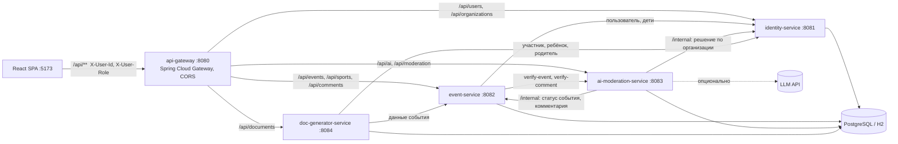

# СпортВместе — платформа совместных спортивных активностей

Прототип для кейса «Столото» (финал ФСП). Человек находит компанию для спорта рядом с домом: дворовый футбол, шахматы в парке, утренние пробежки. Он может записаться сам, записать ребёнка или собрать своё мероприятие. Клубы проходят проверку администратора, а каждое мероприятие перед публикацией проверяет ИИ-модератор.

- **Фронтенд:** React 19, TypeScript, Vite, Tailwind CSS v4, Lucide, React Router, Яндекс Карты JS API 2.1.
- **Бэкенд:** Java 21, Spring Boot 3.3, Spring Cloud Gateway. Многомодульный Maven-проект из 6 модулей.
- **Хранилище:** PostgreSQL 16 в Docker или файловая H2 для запуска без Docker.

Все действия сохраняются в БД. Если переключиться на другую роль, результат сразу виден: организатор принял заявку — участник видит статус «Вы в составе участников».

---

## Быстрый старт

### Вариант 1. Одной командой, без Docker (Windows)

```powershell
.\start.ps1            # собрать (если нужно) и запустить 5 сервисов и фронтенд
.\start.ps1 -ResetData # то же, но с чистыми демо-данными
.\stop.ps1             # остановить всё
```

Linux и macOS: `./start.sh` и `./stop.sh`.

Скрипт:
1. Находит Java 21. Если её нет, скачивает Temurin JDK в `.tools/`.
2. Собирает бэкенд через Maven Wrapper (Maven ставить не нужно).
3. Запускает сервисы с профилем `local`: общая файловая H2 в `backend/data`, логи в `backend/logs`.
4. Выполняет `npm install` при необходимости и запускает Vite.

Нужен только Node.js 20+. Откройте **http://localhost:5173**.

### Вариант 2. Docker Compose (PostgreSQL)

```bash
docker compose up --build
```

Поднимаются `postgres:16`, все Java-сервисы (профиль `docker`) и фронтенд на nginx. Адреса те же: фронтенд на http://localhost:5173, шлюз на http://localhost:8080.

### Переменные окружения (все необязательные)

| Переменная | Где | Назначение |
|---|---|---|
| `VITE_YANDEX_MAPS_API_KEY` | frontend | Ключ JS API Яндекс Карт. Без ключа карты работают, но не работает поиск адреса (геокодер). |
| `VITE_API_URL` | frontend | Адрес шлюза, по умолчанию `http://localhost:8080`. |
| `AI_LLM_API_KEY` | ai-moderation-service | Ключ любого OpenAI-совместимого API. Без ключа работает встроенный Java-анализатор. |
| `AI_LLM_BASE_URL`, `AI_LLM_MODEL` | ai-moderation-service | По умолчанию `https://api.openai.com/v1` и `gpt-4o-mini`. Подойдут YandexGPT через совместимый эндпоинт или локальная Ollama. |
| `FRONTEND_ORIGINS` | api-gateway | Разрешённые CORS-origin, по умолчанию `*`. |
| `SPORT_DATA_DIR` | все сервисы, профиль `local` | Каталог H2-базы. |

---

## Архитектура



| Модуль | Порт | Ответственность |
|---|---|---|
| `common-lib` | — | Общие enum (`RoleType`, `EventStatus`, `RegistrationMode`, `ApplicationStatus`, `AiStatus`, `AgeRestriction`…), межсервисные DTO-records, единый формат ошибок `ApiError` и `GlobalExceptionHandler`, `CurrentUser` из заголовков `X-User-Id` и `X-User-Role` (через `HandlerMethodArgumentResolver`), `DemoIds`. |
| `api-gateway` | 8080 | Единая точка входа, маршрутизация и CORS. Маршруты `/internal/**` наружу не публикуются. |
| `identity-service` | 8081 | Аккаунты и роли, детские аккаунты, привязанные к родителю, анкеты организаций и их статус допуска. |
| `event-service` | 8082 | Мероприятия с координатами, динамический справочник видов спорта, записи в режимах FREE и BY_APPLICATION, обсуждения. |
| `ai-moderation-service` | 8083 | ИИ-проверка событий и комментариев (эвристика плюс опциональная LLM), настройки ИИ, ручная модерация администратора, журнал действий. |
| `doc-generator-service` | 8084 | Шаблоны заявлений с плейсхолдерами в БД, генерация готового HTML-документа для печати и сохранения в PDF. |

**Ключевые решения:**
- **Авторизация имитируется.** Фронтенд передаёт `X-User-Id` и `X-User-Role` выбранного демо-аккаунта. Права проверяют сами сервисы: роль, владение событием, допуск организации. Подменить роль и, например, принять заявку на чужое событие нельзя: сервис ответит `403`.
- **Межсервисные вызовы.** Используется `RestClient` с таймаутами. Если ai-moderation-service недоступен, event-service всё равно создаёт событие с безопасным вердиктом по умолчанию («требует проверки», 18+).
- **Хранилище.** Каждый сервис владеет своими таблицами, а физически база одна (`sportdb`), чтобы запуск оставался простым. Ссылки между сервисами хранятся как id, без внешних ключей между чужими таблицами.
- **Обработка ошибок.** Все ошибки приходят в одном формате `{status, code, message, fields}` с русскими сообщениями, и фронтенд показывает их как есть.

### Структура репозитория

```
backend/
  pom.xml                    — родительский POM (Spring Boot 3.3.5, Spring Cloud 2023.0.3)
  common-lib/ api-gateway/ identity-service/ event-service/ ai-moderation-service/ doc-generator-service/
  Dockerfile                 — один Dockerfile на все сервисы (ARG SERVICE)
frontend/
  src/api                    — типы и клиент API
  src/auth                   — демо-сессия и переключатель ролей
  src/components             — UI-кит, карты, бейджи, диалоги, обсуждение
  src/pages                  — афиша, событие, форма, клубы, кабинет, админка
docker-compose.yml  start.ps1 / start.sh  stop.ps1 / stop.sh
```

---

## Схема данных

```mermaid
erDiagram
  user_accounts ||--o{ user_accounts : "parent_id (дети)"
  user_accounts ||--o| organizations : "owner_user_id"
  sport_types ||--o{ sport_events : sport_type_id
  sport_events ||--o{ event_registrations : event_id
  sport_events ||--o{ event_comments : event_id
  event_comments ||--o{ event_comments : "parent_id (ответы)"
  sport_events ||--o{ ai_verdicts : event_id

  user_accounts { bigint id PK; string display_name; string email; enum role; int age; bigint parent_id; string city; string interests; bool demo }
  organizations { bigint id PK; string name; text description; string sports_interests; enum status; string rejection_reason; bigint owner_user_id; timestamp reviewed_at }
  sport_types { bigint id PK; string name; string name_key UK; string emoji; bool custom }
  sport_events { bigint id PK; string title; text description; bigint sport_type_id; timestamp start_at; int duration_minutes; string address; double latitude; double longitude; text conditions; enum registration_mode; enum status; enum organizer_type; bigint organizer_user_id; bigint organization_id; enum ai_status; enum age_restriction; string ai_summary; string moderation_reason }
  event_registrations { bigint id PK; bigint event_id; bigint participant_id; bool child; bigint registered_by_id; enum status; string message; string decision_comment }
  event_comments { bigint id PK; bigint event_id; bigint parent_id; bigint author_id; bool organizer_reply; text text; bool hidden; bool hidden_by_ai; string hidden_reason }
  ai_verdicts { bigint id PK; bigint event_id; enum status; enum age_restriction; string summary; string reasons; string source; bool hold }
  moderation_settings { bigint id PK; bool ai_enabled; bool auto_hold_flagged; bool llm_enabled; bool comment_filter_enabled; text custom_stop_words }
  moderation_actions { bigint id PK; enum type; string target_type; bigint target_id; string target_title; string reason; bigint admin_id; timestamp created_at }
  document_templates { bigint id PK; string code UK; string name; text content; string updated_by }
```

**Статусы:**
- **Мероприятие:** `PUBLISHED` (в афише), `ON_REVIEW` (ИИ нашёл нарушения, ждёт администратора), `UNPUBLISHED` (снято с публикации с причиной), `DELETED`.
- **Заявка и организация:** `PENDING`, `APPROVED`, `REJECTED`, `CANCELLED`.
- **Вердикт ИИ:** `AI_APPROVED` или `FLAGGED`, плюс возрастной допуск `CHILD_SAFE` или `ADULT_ONLY`. Ребёнок видит только события, у которых одновременно `CHILD_SAFE` и `AI_APPROVED`.

---

## Демо-аккаунты

Пароли не нужны. Аккаунт выбирается на странице входа или в переключателе ролей в шапке.

| id | Аккаунт | Роль | Для чего |
|---|---|---|---|
| 1 | **Алексей Петров** | USER | Взрослый. Организует «Шахматный блиц», родитель Миши. |
| 2 | **Миша Петров**, 11 лет | CHILD | Видит только безопасные события; при записи формируется согласие родителя. |
| 3 | **Елена Смирнова** | ADMIN | Модерация организаций, событий, обсуждений и ИИ. |
| 4 | **Сергей Волков** | ORGANIZATION | Владелец одобренного клуба «Дворовые легенды». У его футбольного события 2 заявки ждут решения. |
| 5 | **Ольга Кузнецова** | ORGANIZATION | Шахматный клуб «Ладья» на рассмотрении: страница скрыта, создание событий заблокировано. |
| 6 | Ирина Соколова | USER | Второй участник. Организует пробежку. |
| 7 | Дмитрий Орлов | USER | Организует скандinavскую ходьбу (по заявке). Автор события, задержанного ИИ. |
| 8 | **Мария Петрова** | USER | Супруга Алексея в демо-семье; может записывать Мишу на занятия. |

Демо-мероприятия расположены в Красноярске:

| # | Событие | Особенность |
|---|---|---|
| 1 | Дворовый футбол 5×5 — вечерняя игра | клуб, **по заявке**, 18+, 2 заявки `PENDING` (Ирина, Дмитрий) |
| 2 | Шахматный блиц в Центральном парке | свободная запись, можно детям |
| 3 | Утренняя пробежка 5 км по острову Татышев | свободная запись |
| 4 | Детская зарядка во дворе | клуб, для детей |
| 5 | Скандинавская ходьба на набережной Енисея | своё направление, по заявке |
| 6 | Спарринг на деньги — ставки у входа | `FLAGGED`, лежит на проверке у администратора |

Чтобы вернуть исходные данные, запустите `.\start.ps1 -ResetData` (в Docker: `docker compose down -v`).

---

## Прохождение 6 базовых сценариев

### Сценарий 1. Своё направление и мероприятие на карте
1. Войдите как **Алексей Петров** и нажмите **«Создать»**.
2. В поле «Направление» выберите **«➕ Своё направление…»** и введите, например, «Фрисби».
3. Кликните по карте, чтобы поставить точку. Если задан ключ Яндекса, можно ввести адрес и нажать «Найти».
4. Выберите режим записи и нажмите **«Опубликовать»**. ИИ-модератор вернёт вердикт и возрастную метку, они появятся на странице события.
5. Новое направление теперь есть в справочнике и в фильтрах афиши. Если ввести «фрисби» ещё раз, дубль не создастся.
6. На вкладке **«Карта»** у события есть пин. На странице события есть мини-карта и кнопка **«Построить маршрут в Яндекс Картах»**.

### Сценарий 2. Организация: заявка, отказ с причиной, допуск
1. Войдите как **Ольга Кузнецова**. Кабинет показывает «Статус заявки: На рассмотрении», а «Создать» заблокирован.
2. Переключитесь на **Елену Смирнову**: **Модерация**, вкладка **Организации**, клуб «Ладья», **«Отклонить»**. Без причины отклонить нельзя.
3. Вернитесь к Ольге: видна причина отказа. Нажмите **«Исправить и отправить»**, и заявка снова уходит на рассмотрение.
4. Елена нажимает **«Одобрить»**. Клуб появляется в разделе **«Клубы»**, а Ольга может публиковать мероприятия. События одобренной организации выходят сразу, без премодерации.
5. Новую организацию можно зарегистрировать на странице входа: «Я представляю клуб».

### Сценарий 3. Свободная запись
1. Войдите как **Ирина Соколова** и откройте «Шахматный блиц».
2. Нажмите **«Записаться»**. Ирина сразу в составе участников, счётчик мест уменьшается, и открывается блок «Информация для участников» с контактами организатора.
3. Запись появляется в **Кабинете** на вкладке «Мои записи». Её можно отменить.

### Сценарий 4. Запись по заявке: принять или отклонить
1. Войдите как **Сергей Волков** и откройте «Дворовый футбол 5×5».
2. В панели **«Вы организатор»** две заявки с сообщениями. Примите одну, а другую отклоните с комментарием.
3. Переключитесь на **Ирину** или **Дмитрия**: на странице события и в кабинете виден новый статус и комментарий организатора.
4. Администратор заявки участников не рассматривает: принимать их может только организатор события.

### Сценарий 5. Обсуждение мероприятия
1. Под любым событием напишите вопрос, например от Алексея.
2. Переключитесь на организатора и нажмите **«Ответить»**. Ответ помечается бейджем **«Организатор»** и выделяется цветом.
3. Сообщение с оскорблениями или спамом ИИ-фильтр скроет автоматически. Автор увидит причину, остальные увидят «Сообщение скрыто модератором».

### Сценарий 6. Снятие мероприятия с публикации
1. Войдите как **Елена Смирнова** и откройте любое событие (или вкладку **Мероприятия** в админке).
2. Нажмите **«Снять с публикации»** и укажите причину. Можно выбрать готовую.
3. Событие исчезает из афиши. Организатор и записанные участники видят красный баннер с причиной. Записаться нельзя даже по прямой ссылке: и кнопка, и API вернут отказ.
4. Действие записывается в **Журнал**. Там же событие можно восстановить.
5. В обсуждении администратор может скрыть или удалить отдельный комментарий, не трогая само мероприятие.

---

## Дополнительные возможности

- **Детский аккаунт.**
  - Ребёнок видит только события `CHILD_SAFE` и `AI_APPROVED`, о чём сообщает баннер «Детский режим».
  - Если ребёнок записывается сам (войдите как **Миша** и откройте «Детскую зарядку»), автоматически формируется **согласие родителя** с данными события, ребёнка и родителя.
  - Родитель в **Кабинете** на вкладке «Дети» добавляет детские аккаунты и записывает ребёнка прямо со страницы события.
- **ИИ-модератор.**
  - Проверяет название, описание и условия по категориям: азартные игры и ставки, алкоголь, насилие, оскорбления, мошенничество, поздние часы, взрослые темы. Используются границы слов, поэтому «выставка», «подножка» и «контактный телефон» ложных срабатываний не дают.
  - Ставит возрастную метку и пишет краткое заключение на карточке события.
  - События пользователей с нарушениями уходят на проверку (`ON_REVIEW`). Пример — «Спарринг на деньги».
  - В админке, на вкладке «ИИ-модерация», можно включить или выключить проверки, LLM и фильтр обсуждений, задать свои стоп-слова и посмотреть ленту вердиктов.
  - Если задан `AI_LLM_API_KEY`, к эвристике добавляется LLM-проверка, и результаты объединяются.
- **Конструктор заявлений.**
  - Админка, вкладка «Шаблоны документов»: редактор HTML-шаблона, вставка плейсхолдеров кликом, предпросмотр, загрузка `.html` или `.txt`, сброс к шаблону по умолчанию.
  - Доступные плейсхолдеры: `{{eventTitle}}`, `{{sportType}}`, `{{eventDate}}`, `{{eventTime}}`, `{{location}}`, `{{organizerName}}`, `{{conditions}}`, `{{participantName}}`, `{{participantAge}}`, `{{childName}}`, `{{childAge}}`, `{{parentName}}`, `{{currentDate}}`, `{{documentNumber}}`.
  - Документ открывается в один клик со страницы события. Его можно напечатать, сохранить в PDF через печать браузера или скачать HTML.
  - Прямая ссылка: `GET /api/documents/generate/{eventId}?userId=1[&childId=2][&download=true]`.
- **Фильтры афиши:** поиск, направление, дата (сегодня, выходные, неделя), режим записи, «Можно с детьми». Вид переключается между списком и картой; пины клубов на карте оранжевые, пины пользователей синие.
- **Доступность.** Кнопка **«T»** в шапке включает крупный шрифт для пожилых пользователей. Предусмотрены крупные кнопки и поля, контрастные статусы и мобильная нижняя навигация.
- **Журнал модерации:** каждое решение администратора сохраняется с причиной, автором и временем.

---

## API (через шлюз `http://localhost:8080`)

| Метод и путь | Описание |
|---|---|
| `GET /api/users?demo=true`, `GET/PUT /api/users/{id}`, `POST /api/users` | Аккаунты и регистрация (USER или ORGANIZATION) |
| `GET/POST /api/users/{id}/children` | Детские аккаунты |
| `GET /api/organizations`, `GET /api/organizations/my`, `POST`, `PUT /{id}` | Организации и анкета-заявка |
| `GET /api/sports`, `POST /api/sports` | Справочник направлений |
| `GET /api/events?q&sportTypeId&mode&from&to&childSafe&organizationId&scope&status` | Афиша с фильтрами |
| `GET/POST /api/events`, `GET/PUT /api/events/{id}`, `GET /api/events/my` | Мероприятия |
| `POST /api/events/{id}/registrations` (`{childId?, message?}`) | Записаться самому или записать ребёнка |
| `GET /api/events/{id}/registrations`, `POST .../{rid}/decision`, `POST .../{rid}/cancel` | Заявки: просмотр, решение организатора, отмена |
| `GET /api/events/registrations/my` | Мои записи |
| `GET/POST /api/events/{id}/comments`, `DELETE /api/comments/{id}`, `GET /api/comments` | Обсуждение |
| `POST /api/ai/verify-event`, `POST /api/ai/verify-comment`, `GET /api/ai/verdicts`, `GET/PUT /api/ai/settings` | ИИ-модерация |
| `POST /api/moderation/organizations/{id}/approve` и `/reject` | Решение по организации (`{reason}` обязателен при отказе) |
| `POST /api/moderation/events/{id}/unpublish`, `/delete`, `/publish` | Публикация событий |
| `POST /api/moderation/comments/{id}/hide`, `/restore`, `/delete` | Модерация комментариев |
| `GET /api/moderation/journal` | Журнал |
| `GET /api/documents/generate/{eventId}?userId&childId`, `GET /api/documents/preview/{eventId}` | Генерация документа |
| `GET /api/documents/templates`, `PUT /{code}`, `POST /{code}/upload`, `POST /{code}/reset`, `GET /api/documents/placeholders` | Шаблоны |

Заголовки `X-User-Id` и `X-User-Role` фронтенд выставляет сам. Для ручных запросов, например через curl, передавайте их явно.

---

## Что имитируется и ограничения прототипа

- Вход без пароля через демо-аккаунты. Роль передаётся заголовками, JWT и OAuth не реализованы. Для продакшена шлюз должен проверять токен и сам выставлять `X-User-*`.
- Без ключа Яндекс Карт не работает геокодер, то есть поиск по адресу. Точку ставят кликом по карте, координаты сохраняются.
- PDF создаётся через печать браузера («Сохранить как PDF»), серверного PDF-рендера нет.
- Уведомления (email, push) не отправляются: статусы показываются в интерфейсе и в кабинете.
- `docker-compose.yml` подготовлен для PostgreSQL, но на машине разработчика проверялся вариант без Docker (H2). Схема создаётся Hibernate (`ddl-auto: update`).
