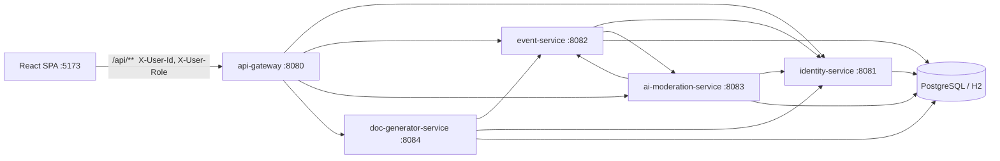

# СпортВместе

Прототип платформы совместных спортивных активностей (кейс «Столото», финал ФСП). Пользователь находит компанию для спорта рядом с домом, записывается сам, записывает ребёнка или организует своё мероприятие. Клубы проходят проверку администратора; события от частных организаторов — ИИ-модерацию.

| Слой | Стек |
|---|---|
| Фронтенд | React 19, TypeScript, Vite, Tailwind CSS v4, React Router, Яндекс Карты JS API 2.1 |
| Бэкенд | Java 21, Spring Boot 3.3, Spring Cloud Gateway, 5 сервисов + `common-lib` |
| Данные | PostgreSQL 16 (Docker) или общая файловая H2 (локально без Docker) |

Подробнее для разработчиков: [docs/README.md](docs/README.md) (архитектура, доменные правила, рецепты изменений).

---

## Быстрый старт

**Windows:** `.\start.ps1` / `.\start.ps1 -ResetData` / `.\stop.ps1`

**Linux и macOS:** `./start.sh` / `./start.sh --reset` / `./stop.sh`

Скрипт при необходимости подтягивает JDK 21, собирает бэкенд через Maven Wrapper, поднимает пять Java-сервисов (профиль `local`, H2 в `backend/data`) и Vite. Нужен Node.js 20+.

- UI: **http://localhost:5173**
- API-шлюз: **http://localhost:8080**

**Docker Compose** (PostgreSQL):

```bash
docker compose up --build
# или одной командой (останавливает локальные jar/vite, при необходимости — host-сеть):
bash docker-up.sh
```

Те же порты 5173 и 8080. Если контейнеры не видят Postgres по имени `postgres`, используйте `docker compose -f docker-compose.yml -f docker-compose.host.yml up --build -d` (см. `docker-compose.host.yml`).

### Переменные окружения (необязательные)

| Переменная | Где | Назначение |
|---|---|---|
| `VITE_NOMINATIM_URL`, `VITE_OSRM_URL` | frontend | Необязательно: свой Nominatim/OSRM; по умолчанию публичные сервисы OpenStreetMap (ключ не нужен) |
| `VITE_API_URL` | frontend | Шлюз, по умолчанию `http://localhost:8080` |
| `AI_LLM_API_KEY` | ai-moderation-service | OpenAI-совместимый API; без ключа — только Java-эвристика |
| `AI_LLM_BASE_URL`, `AI_LLM_MODEL` | ai-moderation-service | По умолчанию OpenAI / `gpt-4o-mini`; подойдут YandexGPT или Ollama |
| `FRONTEND_ORIGINS` | api-gateway | CORS, по умолчанию `*` |
| `SPORT_DATA_DIR` | сервисы, профиль `local` | Каталог H2 |

---

## Архитектура



| Сервис | Порт | Зона ответственности |
|---|---|---|
| `api-gateway` | 8080 | Маршрутизация, CORS; `/internal/**` наружу не отдаётся |
| `identity-service` | 8081 | Пользователи, роли, семьи, дети, организации и допуск клубов |
| `event-service` | 8082 | События, справочник видов спорта, записи, обсуждения |
| `ai-moderation-service` | 8083 | ИИ-проверка, настройки, ручная модерация, журнал |
| `doc-generator-service` | 8084 | HTML-шаблоны заявлений и согласий, генерация для печати/PDF |
| `common-lib` | — | Enum, DTO, `ApiError`, `CurrentUser`, `DemoIds` |

**Важно для прототипа:** авторизация имитируется заголовками `X-User-Id` и `X-User-Role` от выбранного демо-аккаунта. Права проверяют сервисы; подмена роли для чужих действий даёт `403`. Межсервисные вызовы — `RestClient` с таймаутами; при недоступности ИИ событие всё равно создаётся с безопасным вердиктом по умолчанию.

Структура репозитория: `backend/` (Maven-модули), `frontend/src/` (`api`, `auth`, `components`, `pages`), `docker-compose.yml`, `start.ps1` / `start.sh`.

---

## Демо-аккаунты

Пароль не нужен — вход и переключатель ролей в шапке. Id зафиксированы в `DemoIds`; новых демо-пользователей добавляют **только в конец** списка сидов.

| id | Имя | Роль | Зачем в демо |
|---|---|---|---|
| 1 | **Алексей Петров** | USER | Организатор «Шахматный блиц», отец Миши, муж в демо-семье |
| 2 | **Миша Петров**, 11 лет | CHILD | Детский режим афиши; при самостоятельной записи — согласие родителя |
| 3 | **Елена Смирнова** | ADMIN | Организации, события, комментарии, ИИ, шаблоны документов |
| 4 | **Сергей Волков** | ORGANIZATION | Клуб «Дворовые легенды» (одобрен); у футбола 2 заявки `PENDING` |
| 5 | **Ольга Кузнецова** | ORGANIZATION | «Ладья» на рассмотрении — события создавать нельзя |
| 6 | Ирина Соколова | USER | Участница, организует пробежку |
| 7 | Дмитрий Орлов | USER | Скандинавская ходьба по заявке; автор события, задержанного ИИ |
| 8 | **Мария Петрова** | USER | Супруга Алексея; та же семья — может записывать Мишу |

Сброс данных: `.\start.ps1 -ResetData` или `./start.sh --reset`; в Docker — `docker compose down -v`.

### Демо-мероприятия (Красноярск)

| # | Событие | Особенность |
|---|---|---|
| 1 | Дворовый футбол 5×5 | клуб, по заявке, 18+, заявки Ирины и Дмитрия |
| 2 | Шахматный блиц | свободная запись, можно с детьми |
| 3 | Утренняя пробежка 5 км | свободная запись |
| 4 | Детская зарядка | для детей |
| 5 | Скандинавская ходьба | своё направление, по заявке |
| 6 | Спарринг на деньги | `FLAGGED`, на проверке у администратора |

---

## Семья и дети

Для прототипа семья — два взрослых `USER` **разного пола** (`Gender`), у обоих указан пол в профиле и ещё нет `familyId`.

1. В **Кабинете** → вкладка **«Семья»** выберите партнёра (список с бэкенда: `GET /api/families/eligible-spouses`) и создайте семью.
2. После этого любой из родителей может добавить детей (раньше без семьи добавление заблокировано).
3. Дети привязаны к `familyId`; у каждого есть `parentId` (кто оформил аккаунт). Оба родителя видят всех детей семьи, могут записывать их на события и формировать согласие.

В демо Алексей (1) и Мария (8) уже в одной семье с Мишей (2).

---

## Шесть базовых сценариев

1. **Своё направление и точка на карте** — Алексей, «Создать», «➕ Своё направление», клик по карте, публикация и вердикт ИИ; новое направление в фильтрах афиши.
2. **Клуб: заявка и допуск** — Ольга (на рассмотрении) → Елена отклоняет с причиной → Ольга исправляет → Елена одобряет → события клуба без премодерации.
3. **Свободная запись** — Ирина на «Шахматный блиц» → сразу в составе → запись в кабинете, можно отменить.
4. **Запись по заявке** — Сергей принимает/отклоняет заявки на футбол; участники видят статус; админ заявки не решает.
5. **Обсуждение** — вопрос участника, ответ организатора с бейджем; грубость скрывает ИИ-фильтр.
6. **Снятие с публикации** — Елена снимает событие с причиной → исчезает из афиши, баннер у организатора и участников; действие в журнале.

---

## Дополнительные возможности

- **Детский режим:** только `CHILD_SAFE` + `AI_APPROVED`; согласие родителя при записи ребёнка (шаблон `CHILD_CONSENT`).
- **ИИ-модератор:** эвристика по категориям риска, опционально LLM; `ON_REVIEW` для нарушений; настройки и лента вердиктов в админке.
- **Конструктор заявлений:** HTML-шаблоны с плейсхолдерами в админке; генерация с события или `GET /api/documents/generate/{eventId}?userId=…`.
- **Афиша:** фильтры, список/карта; пины клубов и пользователей разного цвета.
- **Доступность:** крупный шрифт («T» в шапке), контраст, мобильная навигация.

---

## API (шлюз `http://localhost:8080`)

Заголовки `X-User-Id` и `X-User-Role` обязательны для mutating-запросов и для данных «от имени» пользователя.

| Метод и путь | Назначение |
|---|---|
| `GET /api/users?demo=true`, `GET/PUT /api/users/{id}`, `POST /api/users` | Аккаунты, регистрация USER/ORGANIZATION |
| `GET/POST /api/users/{id}/children` | Дети (нужна семья у родителя) |
| `GET /api/families/my`, `GET /api/families/eligible-spouses`, `POST /api/families` | Семья |
| `GET/POST /api/organizations`, `GET /api/organizations/my`, `PUT /{id}` | Клубы |
| `GET/POST /api/sports` | Направления |
| `GET/POST /api/events`, `GET/PUT /api/events/{id}`, `GET /api/events/my` | События |
| `GET /api/events?…` | Афиша (фильтры `q`, `sportTypeId`, `mode`, даты, `childSafe`, …) |
| `POST /api/events/{id}/registrations`, решения и отмена | Записи и заявки |
| `GET/POST /api/events/{id}/comments`, модерация комментариев | Обсуждение |
| `POST /api/ai/…`, `GET/PUT /api/ai/settings` | ИИ |
| `POST /api/moderation/…`, `GET /api/moderation/journal` | Ручная модерация |
| `GET /api/documents/…` | Шаблоны и генерация |

Полная таблица эндпоинтов и внутренние маршруты — в [docs/architecture.md](docs/architecture.md).

---

## Ограничения прототипа

- Нет паролей, JWT и OAuth; для продакшена шлюз должен проверять токен и выставлять `X-User-*` сам.
- PDF — через «Печать → Сохранить как PDF» в браузере.
- Email и push не отправляются.
- Без ключа Яндекс Карт нет геокодера; координаты задают кликом по карте.
- Одна физическая БД `sportdb` на все сервисы; ссылки между доменами — по id без FK между чужими таблицами.
- Hibernate `ddl-auto: update`; локальный запуск чаще проверялся на H2, Docker — на PostgreSQL.

---

## Сборка и проверка

```bash
cd backend && ./mvnw -q -B -DskipTests package
cd frontend && npm run build && npm run lint
```

Автотестов в репозитории нет.
