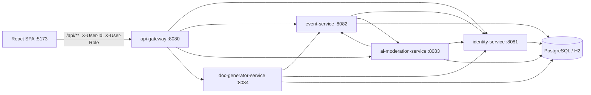

# СпортВместе

Прототип платформы совместных спортивных активностей — кейс «Столото», финал ФСП «Программирование продуктовое». Помогает перейти от «хочу заниматься, но не с кем» к конкретной встрече: кто собирается, где, когда и как присоединиться.

| Слой | Стек |
|---|---|
| Фронтенд | React 19, TypeScript, Vite, Tailwind CSS v4, React Router, Leaflet / Яндекс Карты |
| Бэкенд | Java 21, Spring Boot 3.3, Spring Cloud Gateway, 5 сервисов + `common-lib` |
| Данные | PostgreSQL 16 в Docker; локально — файловая H2 (`backend/data`) |

Внутренняя документация для разработчиков: [docs/README.md](docs/README.md).

---

## Запуск (Docker — рекомендуемый способ)

Нужны **Docker** и **Docker Compose**. Открытые библиотеки; платные подписки для проверки не требуются.

```bash
# из корня репозитория
docker compose up --build
# или с автопроверкой и overlay для облачных VM:
./docker-up.sh
```

- **UI:** http://localhost:5173 (nginx проксирует `/api` на шлюз — достаточно одного порта для демо)
- **API-шлюз:** http://localhost:8080

Сброс демо-данных: `docker compose down -v`.

Если контейнеры не видят Postgres по имени `postgres` (некоторые облачные VM):

```bash
docker compose -f docker-compose.yml -f docker-compose.host.yml up --build -d
```

Состав стека: `postgres`, `identity-service`, `event-service`, `ai-moderation-service`, `doc-generator-service`, `api-gateway`, `frontend`. Образы собираются из [backend/Dockerfile](backend/Dockerfile) и [frontend/Dockerfile](frontend/Dockerfile).

### Переменные окружения

Пример — [.env.example](.env.example). Compose подхватывает `.env` в корне.

| Переменная | Где | Назначение |
|---|---|---|
| `VITE_YANDEX_MAPS_API_KEY` | сборка frontend | Ключ JS API Яндекс Карт; без него карта работает, геокодер «Найти адрес» — нет |
| `AI_LLM_API_KEY` | ai-moderation-service | OpenAI-совместимый API; без ключа — только Java-эвристика |
| `AI_LLM_BASE_URL`, `AI_LLM_MODEL` | ai-moderation-service | По умолчанию OpenAI / `gpt-4o-mini` |
| `FRONTEND_ORIGINS` | api-gateway | CORS, по умолчанию `*` |

### Локальный запуск без Docker

Для разработки: JDK 21, Node.js 20+.

- **Windows:** `.\start.ps1` / `.\start.ps1 -ResetData` / `.\stop.ps1`
- **Linux, macOS:** `./start.sh` / `./start.sh --reset` / `./stop.sh`

H2 в `backend/data`, те же порты 5173 и 8080.

---

## Структура репозитория

```
backend/          Maven-модули (gateway, identity, event, ai-moderation, doc-generator, common-lib)
frontend/src/     SPA: api, auth, components, pages
docker-compose.yml
docker-compose.host.yml
docker-up.sh
start.sh / start.ps1
docs/             Архитектура, доменные правила, рецепты
```

---

## Соответствие техническому заданию

Постановка задачи финала ФСП (платформа совместных спортивных активностей, Столото). Ниже — обязательный минимум и базовые сценарии проверки.

| Требование ТЗ | Как реализовано |
|---|---|
| Три роли: пользователь, организация, администратор | Роли `USER`, `ORGANIZATION`, `ADMIN`; вход через демо-аккаунты и переключатель в шапке |
| Регистрация/вход (допустима имитация) | Экран входа + выбор демо-пользователя; заголовки `X-User-Id`, `X-User-Role`; бизнес-логика меняет данные, не «нарисованные состояния» |
| Создание и публикация мероприятий (человек и допущенная организация) | `EventFormPage`, события от `USER` и от клуба после `APPROVED` |
| Просмотр, поиск, карточка мероприятия | Афиша с фильтрами, текстовый поиск, карта; страница события с полями ТЗ |
| Разные спортивные направления + «своё» без правки кода | Справочник `SportType`, пользовательское название сохраняется в БД |
| Режимы записи: свободное присоединение и по заявке | `FREE` → сразу участник; `BY_APPLICATION` → `PENDING` / решение организатора |
| Участники и заявки для организатора; статус записи для пользователя | Панель организатора, бейджи статусов, «Мои записи» |
| Текстовое обсуждение под мероприятием | Комментарии, бейдж организатора; модерация отдельных сообщений |
| Заявка организации и допуск администратором | Профиль клуба → `PENDING` → решение админа с причиной при отклонении |
| Админ: поиск, просмотр, снятие/удаление мероприятия | Админка: организации, события, комментарии, журнал |
| На снятое событие нельзя записаться | Статусы `UNPUBLISHED` / `DELETED`, проверки в `EventService.registrationBlockedReason` |
| Адаптивный веб-интерфейс | Mobile-first, нижняя навигация, крупный шрифт и контраст |
| Демо-данные для 6 сценариев | Сиды в `DataInitializer`, аккаунты в таблице ниже |

### Базовые сценарии проверки (из ТЗ)

1. **Создание мероприятия пользователем** — своё направление, карта, видно другому пользователю.
2. **Допуск организации** — заявка → решение админа → публикация от клуба без премодерации каждого события.
3. **Свободное присоединение** — запись сразу в составе участников.
4. **Участие по заявке** — ожидание, принятие и отклонение с обновлением у обеих сторон.
5. **Уточнение условий** — вопрос и ответ организатора в обсуждении.
6. **Снятие с публикации** — событие исчезает из выдачи; организатор и участники видят причину.

Подробные шаги с демо-аккаунтами — раздел [«Прохождение сценариев»](#прохождение-сценариев).

---

## Дополнительные возможности (сверх минимума ТЗ)

Не обязательны по постановке; усиливают доверие, семейный сценарий и модерацию.

| Возможность | Кратко |
|---|---|
| **Интерактивная карта** | Афиша на карте (Leaflet/OSM), выбор точки при создании события |
| **ИИ-модерация** | Эвристика + опционально LLM; придержка `ON_REVIEW`, скрытие грубых комментариев |
| **Причины при отклонении организации и снятии события** | Видны организатору в интерфейсе |
| **Журнал действий администратора** | `ModerationAction` в ai-moderation-service |
| **Семья и дети** | Семейный аккаунт, детский режим афиши, согласие родителя при записи ребёнка |
| **Конструктор документов** | HTML-шаблоны согласий/заявлений, генерация для печати/PDF через браузер |
| **Репутация организаторов** | Штраф за снятие админом; отзывы участников после события влияют на баллы |
| **Верификация пользователя (галочка)** | Заявка и решение админа; упрощённая публикация при спорных вердиктах ИИ |
| **Друзья и закрытые мероприятия** | `FRIENDS_ONLY`, приглашения |
| **Лимит мест, отмена записи** | `capacity`, отмена участником |
| **Поиск людей** | Страница «Люди», профили |
| **Доступность** | Переключатель крупного шрифта, тёмная тема, понятные состояния кнопок |
| **Помощник при создании события** | Подсказки и варианты описания (ИИ-агент на форме) |

---

## Перспективы развития

| Направление | Сейчас | Цель |
|---|---|---|
| **Конструктор документов** | Редактор HTML-шаблонов в админке, подстановка полей, печать в PDF | Визуальный конструктор блоков, версии шаблонов, электронная подпись родителя, хранение выданных согласий |
| **ИИ-модерация** | Эвристика + опциональный LLM, ручной контур админа | Снижение ложных срабатываний, объяснимые вердикты, дообучение на журнале решений, модерация медиа |
| **Поддержка пользователей** | Нет тикетов и чата с поддержкой | FAQ, обращения из интерфейса, статусы жалоб, эскалация в админку |
| **Уведомления** | Состояния только в UI | Email/push о заявках, решениях, переносах и отменах |
| **Повторяющиеся встречи и календарь** | Разовые события | Серии тренировок, экспорт в календарь |
| **Настоящая авторизация** | Демо-заголовки | JWT/OAuth на шлюзе, без доверия к клиентским заголовкам |
| **Продакшен-БД** | Одна схема `sportdb`, ddl-auto | Миграции Flyway/Liquibase, разделение схем по сервисам при росте |

---

## Архитектура



| Сервис | Порт | Зона ответственности |
|---|---|---|
| `api-gateway` | 8080 | Маршрутизация, CORS; `/internal/**` наружу не отдаётся |
| `identity-service` | 8081 | Пользователи, роли, семьи, дети, организации, допуск клубов |
| `event-service` | 8082 | События, направления, записи, обсуждения, отзывы |
| `ai-moderation-service` | 8083 | ИИ-проверка, настройки, ручная модерация, журнал |
| `doc-generator-service` | 8084 | Шаблоны заявлений и согласий |
| `common-lib` | — | Enum, DTO, `ApiError`, `CurrentUser`, `DemoIds` |

**Имитации прототипа:** нет паролей, JWT, OAuth, SMS и e-mail; шлюз не проверяет подлинность заголовков пользователя — для продакшена токен должен выставлять только gateway.

---

## Демо-аккаунты

Пароль не нужен — вход и переключатель ролей в шапке. Id зафиксированы в `DemoIds`; новых демо-пользователей добавляют **только в конец** списка сидов.

| id | Имя | Роль | Зачем в демо |
|---|---|---|---|
| 1 | **Алексей Петров** | USER | Организатор «Шахматный блиц», отец Миши |
| 2 | **Миша Петров**, 11 лет | CHILD | Детский режим афиши |
| 3 | **Елена Смирнова** | ADMIN | Организации, события, ИИ, документы |
| 4 | **Сергей Волков** | ORGANIZATION | Клуб «Дворовые легенды» (одобрен) |
| 5 | **Ольга Кузнецова** | ORGANIZATION | «Ладья» на рассмотрении |
| 6 | Ирина Соколова | USER | Участница |
| 7 | Дмитрий Орлов | USER | Событие, задержанное ИИ |
| 8 | **Мария Петрова** | USER | Супруга Алексея, семья с Мишей |

### Демо-мероприятия (Красноярск)

| # | Событие | Особенность |
|---|---|---|
| 1 | Дворовый футбол 5×5 | клуб, по заявке, заявки в ожидании |
| 2 | Шахматный блиц | свободная запись |
| 3 | Утренняя пробежка 5 км | свободная запись |
| 4 | Детская зарядка | для детей |
| 5 | Скандинавская ходьба | своё направление, по заявке |
| 6 | Спарринг на деньги | `FLAGGED`, на проверке у администратора |

---

## Прохождение сценариев

1. **Своё направление** — Алексей → «Создать» → «➕ Своё направление» → карта → публикация.
2. **Клуб** — Ольга (ожидание) → Елена отклоняет/одобряет → события клуба без премодерации.
3. **Свободная запись** — Ирина на «Шахматный блиц» → сразу в составе.
4. **По заявке** — Сергей принимает/отклоняет заявки на футбол.
5. **Обсуждение** — вопрос участника, ответ организатора.
6. **Снятие с публикации** — Елена снимает событие с причиной → нет в афише, баннер у затронутых.

---

## Правила доступа и модерации (кратко)

- Организация публикует только после **допуска** администратором.
- События **клуба** после допуска — без обязательной премодерации каждого; админ может снять с публикации.
- События **частного пользователя** при рискованном вердикте ИИ могут уйти в **`ON_REVIEW`** до решения админа.
- Заявки на участие рассматривает **организатор**, не администратор.
- Публичные обсуждения открытых мероприятий доступны всем авторизованным; некорректные комментарии скрываются модерацией.

Полные правила: [docs/domain-rules.md](docs/domain-rules.md), ИИ: [docs/ai-moderation.md](docs/ai-moderation.md).

---

## Сборка и проверка

```bash
cd backend && ./mvnw -q -B test package
cd frontend && npm run build && npm run lint
```

**Автотесты (JUnit 5):** `common-lib` — репутация и запрещённый контент; `ai-moderation-service` — эвристика модератора. Интеграционных e2e-тестов пока нет.

---

## Известные ограничения

- PDF — через «Печать → Сохранить как PDF» в браузере.
- Email и push не отправляются.
- Без ключа Яндекс Карт нет геокодера; координаты можно задать кликом по карте.
- Одна БД `sportdb` на все сервисы; межсервисные ссылки — по id.
- Hibernate `ddl-auto: update`.

Технический долг: [docs/known-issues.md](docs/known-issues.md).
