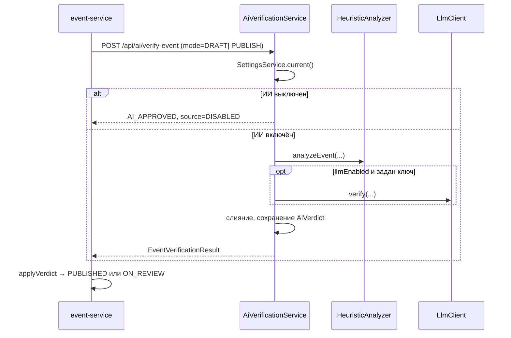

# ИИ-модерация

Код: `backend/ai-moderation-service/src/main/java/ru/sportplatform/moderation/`.

## Поток проверки события

## Правила слияния вердиктов

`AiVerificationService.verifyEvent`:

- `flagged` — нарушение нашёл хотя бы один анализатор.
- `adultOnly` — эвристика нашла взрослые маркеры, **или** есть нарушение, **или** LLM считает, что событие не для детей. Итог: «безопасно для детей» только при согласии обоих анализаторов.
- `hold = flagged && autoHoldFlagged`. Придержку применяет event-service и только к событиям пользователей.
- Причины LLM добавляются с префиксом `LLM:`. К причинам добавляются взрослые или детские маркеры, в зависимости от итоговой метки.
- `source`: `HEURISTIC`, `LLM+HEURISTIC`, `DISABLED`; event-service при недоступности сервиса подставляет `FALLBACK`.
- Каждый вердикт сохраняется в `ai_verdicts`. Лента в админке показывает последние 100.
- Режим `DRAFT` (форма создания): подсказки Event Quality Guardian без записи в ленту вердиктов; вызовы пишутся в `ai_audit_log`.
- Sport Type Curator: `POST /api/ai/normalize-sport` (из event-service через `/api/sports/propose`).

## Эвристика

`HeuristicAnalyzer` работает на регулярных выражениях с флагами `CASE_INSENSITIVE | UNICODE_CASE | UNICODE_CHARACTER_CLASS`. Благодаря `UNICODE_CHARACTER_CLASS` граница `\b` корректно работает для кириллицы.

Анализируется текст «название + описание + условия».

| Группа | Что ищет | Результат |
|---|---|---|
| `FORBIDDEN` | 8 категорий: ставки, алкоголь, наркотики, оружие и насилие, мошенничество, персональные данные, мат, дискриминация | `flagged` |
| Стоп-слова администратора | Подстроки из настроек (разделители `,` `;` и перевод строки, минимум 2 символа, сравнение после `normalizeKey`) | `flagged` |
| `ADULT_MARKERS` | 18+, «только для взрослых», бар, ночной, спарринг, единоборства, контактные виды, сауна | 18+ |
| Позднее время | Начало с 22:00 до 06:00 | 18+ |
| Аудитория `ADULTS` | Выбор организатора | 18+ |
| `KIDS_MARKERS`, аудитория `KIDS` | Дети, ребёнок, школьники, семейный, подростки | Только причины для детской метки, флаг не ставится |
| Рекомендации | Короткое описание (меньше 40 символов), нет условий, КАПС или «!!!» в названии, телефон или ссылка в описании | Подсказки на карточке, на статус не влияют |

На одну категорию сохраняется не больше 5 совпадений.

### Комментарии

`analyzeComment` проверяет только категории с `forComments = true` (алкоголь не проверяется), стоп-слова и спам — больше двух ссылок. Комментарий скрывается, если найдено нарушение и включён `commentFilterEnabled`. Если фильтр выключен, вердикт возвращается с `flagged = true`, но `autoHide = false`.

### Как добавить категорию или маркер

1. Добавьте `category("Название", forComments, "regex1", ...)` в `FORBIDDEN` или шаблон в `ADULT_MARKERS` или `KIDS_MARKERS`.
2. Используйте `\b` и окончания `\w*`, чтобы не ловить части других слов: «ставк» не должно срабатывать в «выставка».
3. Проверьте ложные срабатывания на демо-событиях. Например, создайте событие с текстом-приманкой и посмотрите ленту вердиктов в админке.

Автотестов на эвристику пока нет (см. [known-issues.md](known-issues.md)), поэтому проверять приходится вручную.

## LLM

`LlmClient` подходит для любого OpenAI-совместимого API `/chat/completions`.

| Переменная | По умолчанию |
|---|---|
| `AI_LLM_API_KEY` | пусто, LLM не используется |
| `AI_LLM_BASE_URL` | `https://api.openai.com/v1` |
| `AI_LLM_MODEL` | `gpt-4o-mini` |
| `AI_LLM_TIMEOUT` | 10 секунд |

- `temperature = 0`, системный промпт требует ответить JSON `{flagged, childSafe, summary, reasons}`.
- Из ответа берётся подстрока от первой `{` до последней `}`, поэтому Markdown-обёртка в ответе модели не мешает.
- При ошибке, таймауте или невалидном JSON используется только эвристика. Ошибка пишется в лог с уровнем `warn`.
- LLM проверяет только события, комментарии она не проверяет.

## Настройки

`ModerationSettings` — единственная строка в `moderation_settings`, создаётся при первом обращении (`SettingsService.current`).

| Поле | По умолчанию | Эффект |
|---|---|---|
| `aiEnabled` | `true` | Выключено: события получают `AI_APPROVED` без проверки, комментарии не фильтруются |
| `autoHoldFlagged` | `true` | Придерживать ли события пользователей с `FLAGGED` |
| `llmEnabled` | `true` | Вызывать ли LLM (только если задан ключ) |
| `commentFilterEnabled` | `true` | Автоматически скрывать комментарии с нарушениями |
| `customStopWords` | пусто | Дополнительные стоп-слова |

Изменение настроек записывается в журнал как `SETTINGS_CHANGED`. Настройки читают и меняют только администраторы. В ответе `SettingsDto` есть `llmConfigured` и `model`, по ним админка показывает, подключена ли LLM.
