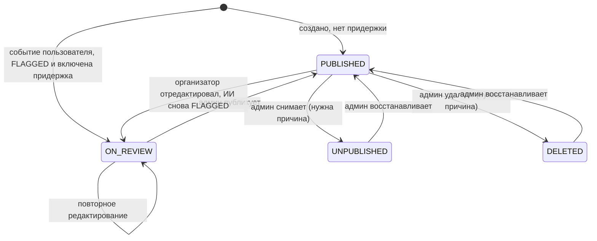
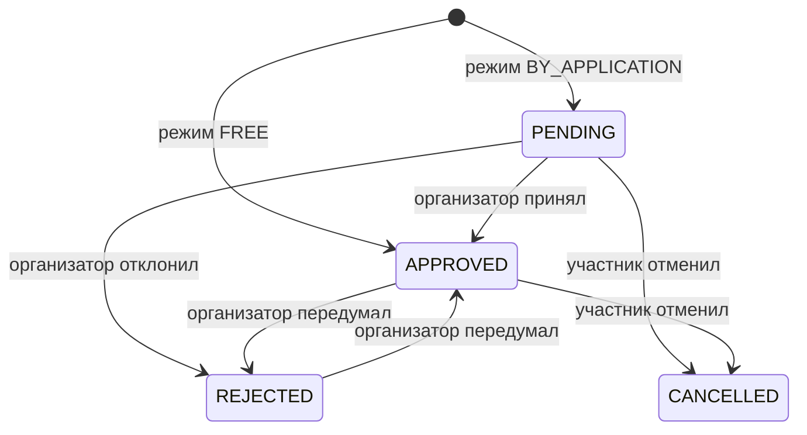
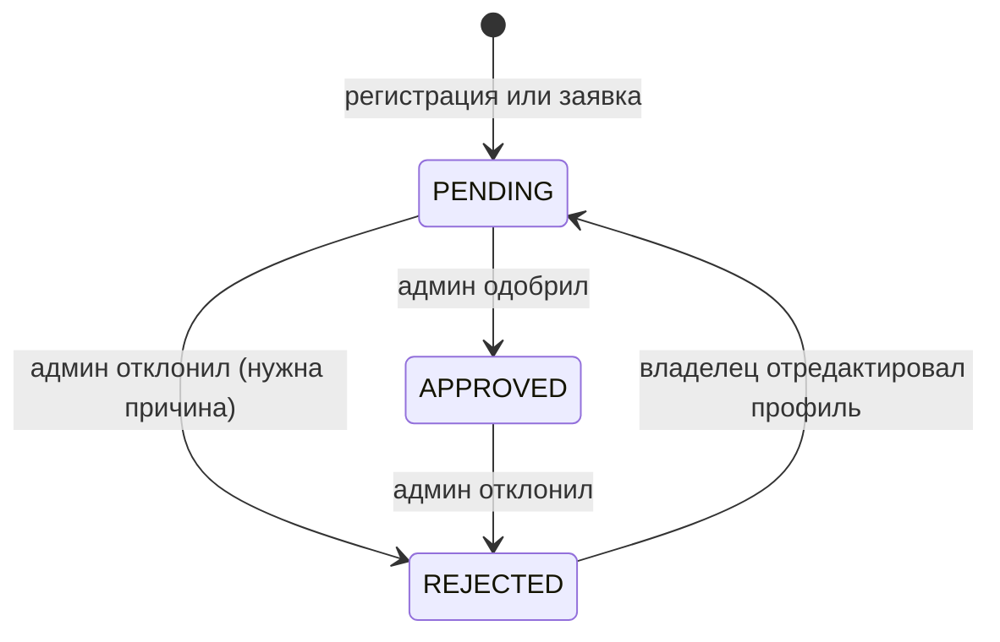

# Бизнес-правила

Здесь собраны правила, которые реализованы в сервисах. Если правило меняется, правьте и код, и этот документ. Ссылки на классы даны относительно `backend/<сервис>/src/main/java/ru/sportplatform/...`.

## Роли

`RoleType` в `common-lib`.

| Действие | USER | CHILD | ORGANIZATION | ADMIN |
|---|---|---|---|---|
| Смотреть афишу | да | только безопасные события | да | да, включая `scope=all` |
| Создавать события | да, но может сработать придержка ИИ | нет | только после допуска, без премодерации | нет |
| Записываться | да | только на безопасные события | нет | нет |
| Записывать ребёнка | да, только своего | нет | нет | нет |
| Решать по заявкам | только на свои события | — | только на свои события | **нет**, заявки рассматривает организатор |
| Комментировать | да | да | да | да |
| Модерация организаций, событий, комментариев, настройки ИИ, шаблоны документов | нет | нет | нет | да |

Самостоятельно можно зарегистрировать только `USER` и `ORGANIZATION` (`UserService.register`). Аккаунт `CHILD` создаёт родитель (`UserService.addChild`), аккаунт `ADMIN` существует только в демо-данных.

## Безопасное для детей событие

Событие безопасно для детей, только если `ageRestriction == CHILD_SAFE` **и** `aiStatus == AI_APPROVED` (`EventService.isChildSafe`). Это условие используется:

- для фильтрации афиши у ребёнка и при фильтре `childSafe=true`;
- для доступа ребёнка к карточке события (иначе 403, если ребёнок ещё не записан);
- для записи ребёнка, как самостоятельной, так и родителем.

Если организатор выбрал аудиторию `ADULTS`, событие всегда получает `ADULT_ONLY`, независимо от вердикта ИИ (`EventService.applyVerdict`).

## Жизненный цикл мероприятия

- Статус ставится в `EventService.applyVerdict` при **каждом** создании и редактировании. Повторная проверка ИИ может вернуть опубликованное событие на проверку. И наоборот: исправленное событие на проверке после редактирования может стать `PUBLISHED`.
- Придержка применяется только к событиям с `organizerType == USER`. Допущенная организация публикует сразу, вердикт `FLAGGED` только подсвечивается администратору.
- `UNPUBLISHED` и `DELETED` организатор редактировать не может (403 с причиной).
- Любой переход, кроме перехода в `PUBLISHED`, требует причину (`EventService.changeStatus`). При публикации причина очищается. Если событие было `FLAGGED`, к `aiSummary` добавляется «Проверено администратором вручную».
- Удаление мягкое: запись в БД остаётся.

### Кто видит карточку

`EventService.findVisible`:

| Статус | Организатор, админ | Записавшийся | Остальные |
|---|---|---|---|
| `PUBLISHED` | да | да | да |
| `UNPUBLISHED` | да | да | да, с баннером, но записаться нельзя |
| `ON_REVIEW` | да | нет | 404 |
| `DELETED` | да | да | 404 |

В публичной афише (`list`) показываются только `PUBLISHED` и не завершившиеся события (если не передан `includePast=true`). Администратор с `scope=all` видит всё, включая прошедшие, и может фильтровать по `status`.

### Валидация формы

- Время начала не раньше чем «сейчас минус 5 минут».
- Число мест (`capacity`) нельзя сделать меньше числа уже подтверждённых участников.
- Направление: либо `sportTypeId` из справочника, либо `customSportName`. Своё название нормализуется (`TextUtils.normalizeKey`: обрезка пробелов, схлопывание пробелов, `ё` → `е`, нижний регистр) и ищется по уникальному `name_key`, поэтому дубль не создаётся. Новое направление получает эмодзи 🏅 и `custom = true`.
- Контакты организатора (`organizerContact`) отдаются только организатору, администратору и подтверждённым участникам (`ViewerState.canSeeContacts`).

## Записи и заявки

`RegistrationService`.

Причины отказа в записи проверяются в одном месте, `EventService.registrationBlockedReason`, в таком порядке:

1. Пользователь не вошёл.
2. Событие `UNPUBLISHED`, `DELETED` или `ON_REVIEW`.
3. Событие уже закончилось.
4. Пользователь — организатор этого события.
5. Пользователь — администратор или организация.
6. Ребёнок, а событие не безопасно для детей.
7. Все места заняты (считаются только `APPROVED`).

Эта же функция заполняет `viewer.canRegister` и `viewer.registrationBlockedReason` в `EventDto`. Поэтому кнопка на фронтенде и API всегда отказывают одинаково. Новое ограничение на запись добавляйте сюда, а не в контроллер или UI.

Дополнительно:

- Повторная активная запись (`PENDING` или `APPROVED`) того же участника запрещена (409).
- Ребёнка записывает только `USER`, который указан у ребёнка в `parentId`. Событие при этом должно быть безопасным для детей.
- `registeredById` хранит того, кто записал, а `participantId` — того, кто участвует. Отменить запись могут оба.
- Принять заявку можно только для `PUBLISHED`-события и только при свободных местах. Отменённую участником заявку принять или отклонить нельзя.
- Список заявок события: организатор и администратор видят всё, остальные видят только `APPROVED` без сообщений, возраста и того, кто записал.

## Обсуждения

`CommentService`.

- Комментировать может любой вошедший пользователь, которому видна карточка события. Для `UNPUBLISHED` и `DELETED` обсуждение закрыто.
- Ответ (`parentId`) должен относиться к тому же событию. Вложенность в данных не ограничена.
- Если пишет организатор события, ставится `organizerReply = true`, а для клуба вместо имени человека подставляется название организации.
- Каждый новый комментарий проверяет ИИ. Если `autoHide`, комментарий сохраняется скрытым с `hiddenByAi = true`.
- Текст скрытого комментария видят только автор и администратор (вместе с причиной). Остальным приходит `text = null` и «Сообщение скрыто модератором».
- Автор может удалить своё сообщение. Удаление физическое.
- Администратор через ai-moderation-service скрывает (с причиной), восстанавливает или удаляет комментарий.

## Организации

`OrganizationService`.

- У одного аккаунта `ORGANIZATION` может быть только одна организация.
- Не допущенную организацию видят только владелец и администратор, остальным отдаётся 404. В списке клубов не администратор видит только `APPROVED`.
- Создавать события может только `ORGANIZATION` с `organizationStatus == APPROVED` (`UserDto.isApprovedOrganization`).
- Редактирование одобренной организации статус не меняет.

## Детские аккаунты

- Ребёнок — `UserAccount` с ролью `CHILD` и `parentId`. Город наследуется от родителя.
- Профиль ребёнка может редактировать родитель.
- Ребёнок не создаёт события и видит только безопасные события.

## Документы

`DocumentService` в doc-generator-service.

- Два шаблона по умолчанию: `ADULT_APPLICATION` (заявление участника) и `CHILD_CONSENT` (согласие родителя). Исходники в `resources/templates-default/`.
- Шаблон выбирается автоматически: если передан `childId` или сам `userId` принадлежит ребёнку, берётся согласие, иначе заявление. Явно шаблон задаётся параметром `template`.
- При `childId` пользователь `userId` должен быть родителем этого ребёнка.
- Плейсхолдеры `{{name}}` подставляются с HTML-экранированием. Неизвестный или пустой плейсхолдер заменяется на `________________`.
- Номер документа: `SV-{eventId}-{participantId}-{yyMMdd}`.
- Если шаблон не содержит `<html`, он оборачивается в страницу A4 с кнопкой печати.
- Изменять, загружать и сбрасывать шаблоны может только администратор. Файл `.txt` превращается в абзацы `
`.

## Модерация и журнал

`ModerationService` в ai-moderation-service — единственная точка ручных решений администратора. Каждый метод:

1. Проверяет роль `ADMIN` и получает имя администратора у identity (если не удалось — «Администратор #id»).
2. Вызывает `/internal/**` профильного сервиса.
3. Пишет `ModerationAction` в журнал.

Типы действий: `ORGANIZATION_APPROVED`, `ORGANIZATION_REJECTED`, `EVENT_UNPUBLISHED`, `EVENT_DELETED`, `EVENT_PUBLISHED`, `COMMENT_HIDDEN`, `COMMENT_RESTORED`, `COMMENT_DELETED`, `SETTINGS_CHANGED`. Журнал отдаёт последние 200 записей.
